# Financial Reporting Dashboard

[](https://github.com/HARISPAARTAN/financial-reporting-dashboard/actions/workflows/ci.yml)
[](https://github.com/HARISPAARTAN/financial-reporting-dashboard/actions/workflows/pages.yml)
[](https://github.com/HARISPAARTAN/financial-reporting-dashboard/releases)

Power-BI-Management-GuV für ein fiktives Facility-Services-Unternehmen: ein GuV-Schema mit Zwischensummen und Margen in TMDL, eine Vorzeichenregel für jede Abweichung, Budget nur gegen abgeschlossene Monate, ein Jahresausblick aus Ist und Q4-Forecast, Sicherheit auf Zeilenebene je Abteilung, dreizehn Prüfwerte gegen eine unabhängige Python-Berechnung abgeglichen, dazu eine HTML-Nachbildung als Live-Demo.

English: [README.md](README.md)

## Status

- CI am 2026-11-02 für Commit `c76b48d` bestanden: ruff, die Python-Tests, die Prüfungen, dass Daten, Nachbildungsdaten und Theme einem frischen Lauf entsprechen, der Scrub, die Tests der P&L-Rechnung und der Diagrammoptionen der Nachbildung, Kontrast, Seitengewicht, die Links und der Kit-Abgleich mit portfolio-kit v0.1.0 ([Lauf](<run url>)).
- Die Nachbildung auf GitHub Pages hat am 2026-11-02 die Browserprüfungen von `tools/checks/shots.mjs` und `tools/checks/replica.mjs` bestanden: drei Reiter bei 1440 und 390 px in beiden Themes, die fünf KPI-Werte des Ausgangszustands, die aufgeklappten Zeilen, die Abteilungsbalken und Zurücksetzen, keine Anfrage außerhalb der Seite und kein Konsolenfehler.
- Am 2026-11-02 in Power BI Desktop 2.159.883.0 geprüft: Das Modell lädt die Dateien aus `data/`, jede Seite wird ohne Fehler angezeigt, die dreizehn Abgleichsprüfungen stimmen mit der pandas-Referenz überein, und der Umsatz, den die Leitung Security Services unter der Rolle `Department head` sieht, entspricht R13 ([Abgleich](docs/reconciliation.md)).
- Release v0.1.0 (2026-11-02): [GitHub Releases](https://github.com/HARISPAARTAN/financial-reporting-dashboard/releases/tag/v0.1.0).

## Kundenauftrag

> Wir sind ein Facility-Services-Unternehmen in Graz mit vier Leistungsbereichen (Reinigung, technische Instandhaltung, Sicherheitsdienst, Catering) und zwei Supportabteilungen. Jeden Monat exportiert unser Controlling die Kontensalden nach Kostenstelle und Konto als CSV. Das Budget liegt in einer Excel-Arbeitsmappe mit einem Blatt je Jahr, und nach dem Septemberabschluss kommt ein Blatt mit dem Q4-Forecast dazu. Wir brauchen ein Power-BI-Dashboard für die Geschäftsführung: Erlöse, Aufwände und Margen als echte GuV, Ist gegen Budget nach Abteilung und Monat, den Ausblick auf das Jahresende und einen Blick auf die Betriebsaufwände. Abteilungsleitungen sollen nur ihre eigene Abteilung sehen.

Rebuilt from memory as a demo. The original client's name and data are not used. (Aus dem Gedächtnis als Demo nachgebaut; Name und Daten des ursprünglichen Kundenunternehmens werden nicht verwendet.) Kaldora Facility Services ist ein fiktives Unternehmen; Nutzende, Umfang und Abnahmekriterien stehen in [docs/brief.md](docs/brief.md).

## Live-Demo

[harispaartan.github.io/financial-reporting-dashboard](https://harispaartan.github.io/financial-reporting-dashboard/)

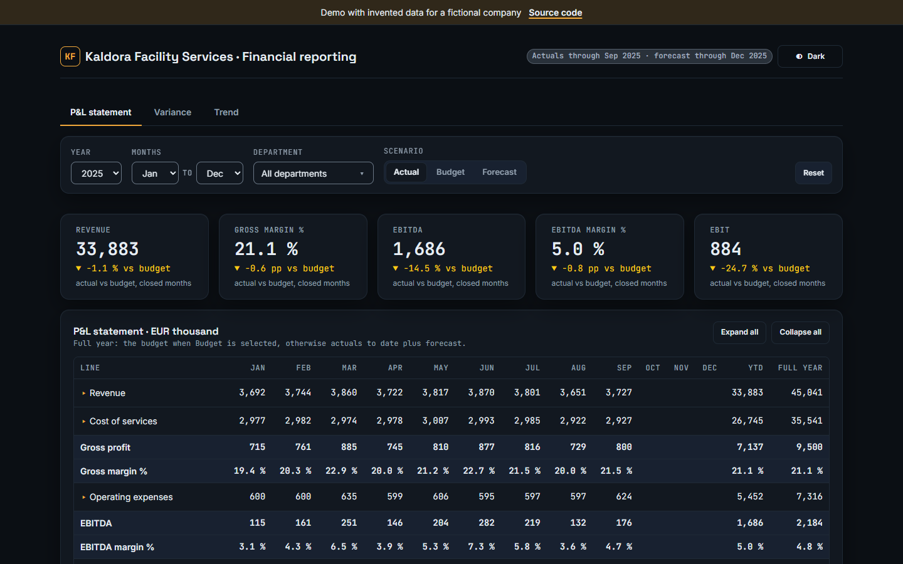

Die Nachbildung ist eine statische Seite mit drei der Berichtsseiten als Reitern (P&L statement, Variance, Trend), denselben Regeln wie der Bericht (Vorzeichenregel, Budget der abgeschlossenen Monate, Ausblick, Status der Abweichung) und den Filtern Jahr, Monate, Abteilung und Szenario, dazu ein Klick auf einen Abteilungsbalken, der Wasserfall und Abweichungstabelle filtert. Sie wird mit ECharts aus den Buchungsdaten gezeichnet, die die Python-Referenz schreibt, läuft im Browser ohne Server und sendet keine Daten; die Filter bleiben nur in diesem Browser gespeichert. Nicht enthalten sind die Seite Opex, der Drillthrough Department detail, die Seite Info (der Abschnitt About ersetzt sie), die Tooltip-Seite, die Abgleichsseite, die Sicherheit auf Zeilenebene, auf dem Reiter Variance die vier EBIT-Kacheln und die Untergruppen- und Kontenzeilen der Abweichungsmatrix und auf dem Reiter Trend die kumulierten Linien und die Ganzjahresdiagramme (das Diagramm zeigt immer 2023 bis 2025).

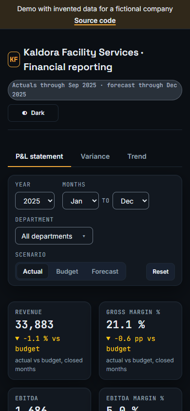

## Was es kann

Acht Berichtsseiten im Design Kaldora Dark: sechs Inhaltsseiten und die verborgene Seite Reconciliation auf einer Fläche von 1280 × 720, die Tooltip-Seite Line tooltip auf 320 × 296. P&L statement hat die Slicer Year, Months, Department und Scenario, Variance analysis und Opex haben Year, Months und Department, Department detail hat Year und Months, Trend hat Department und P&L line, und Info hat keine; jeder Slicer ist über die Seiten synchronisiert, die ihn enthalten, und jede Seite mit Slicern hat eine Schaltfläche Reset. Eine Reihe Kennzahlkacheln steht auf P&L statement, Variance analysis, Opex und Department detail; Trend und Info haben keine.

- **P&L statement**: Umsatz, Bruttomarge in %, EBITDA, EBITDA-Marge in % und EBIT gegen Budget; eine Matrix der zehn GuV-Zeilen mit Untergruppen und Konten darunter, eine Spalte je Monat, YTD und Full year; der Slicer Scenario schaltet die Matrix zwischen Actual, Budget und Forecast (dem Ausblick) um.
- **Variance analysis**: Budget-EBIT, Ist-EBIT, die EBIT-Abweichung und der Jahresausblick gegen Budget; die EBITDA-Abweichung je Abteilung; ein Wasserfall der EBIT-Abweichung nach Kontengruppe; die Abweichungsmatrix mit einem Status je Zeile.
- **Trend**: Ist, Budget und Forecast einer GuV-Zeile je Monat von 2023 bis 2025, die kumulierten Linien innerhalb jedes Jahres und das ganze Jahr.
- **Opex**: Betriebsaufwände gegen Budget, ihr Anteil am Umsatz und der Anteil der Personalkosten; eine Treemap nach Untergruppe und Konto, Opex je Abteilung und die zehn Konten mit den größten Mehrausgaben gegenüber dem Budget.
- **Department detail**: die GuV einer Abteilung und ihr EBITDA je Monat, erreichbar per Drillthrough von einem Abteilungsbalken.
- **Info**: was der Bericht zeigt, die Vorzeichenregel, die Definitionen, die Datendateien und die Quellen.

| P&L statement | Variance analysis |
|---|---|
| 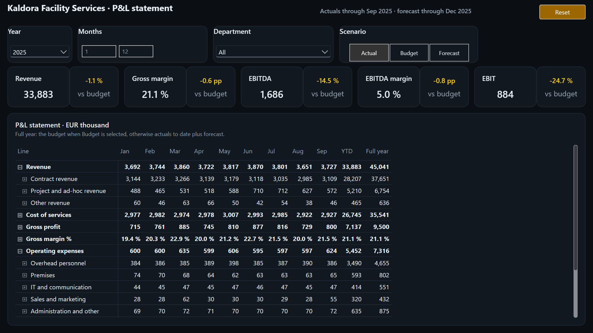 | 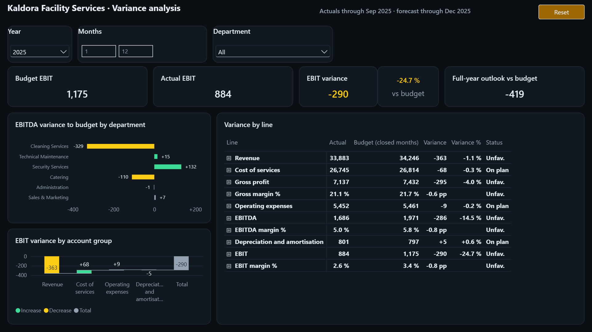 |

| Trend | Opex |
|---|---|
| 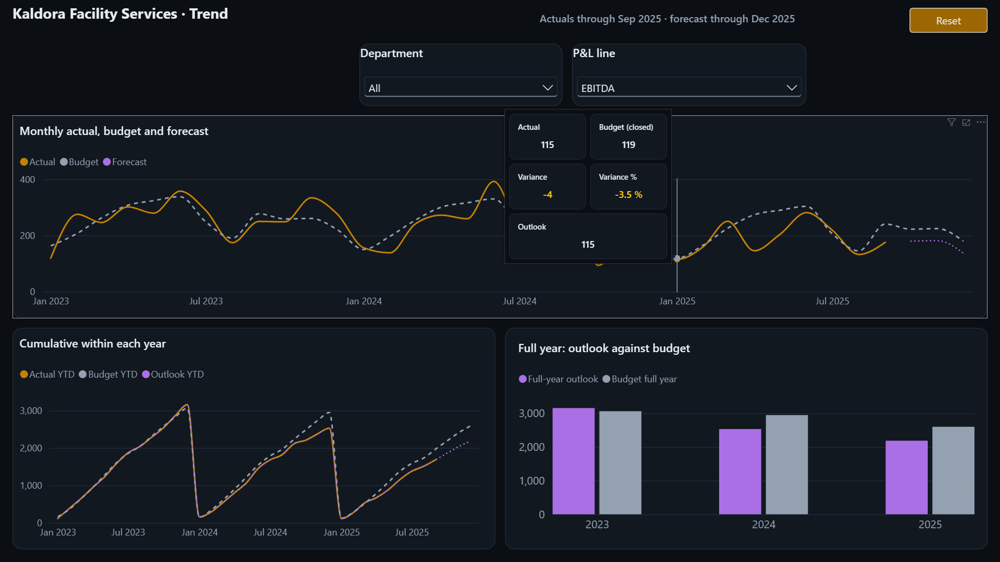 | 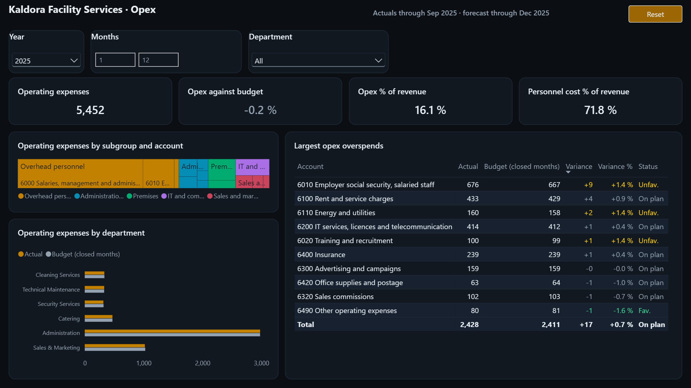 |

| Department detail | Info |
|---|---|
| 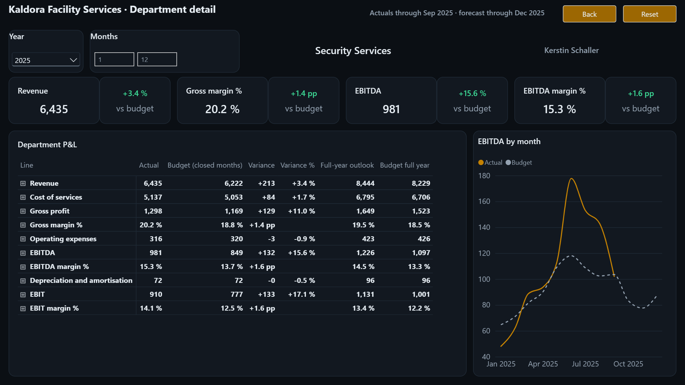 | 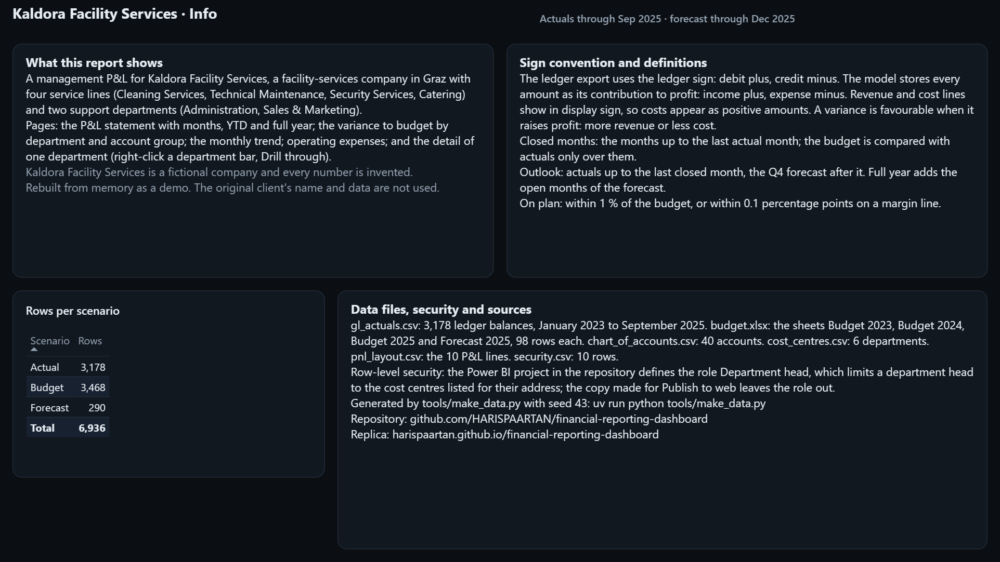 |

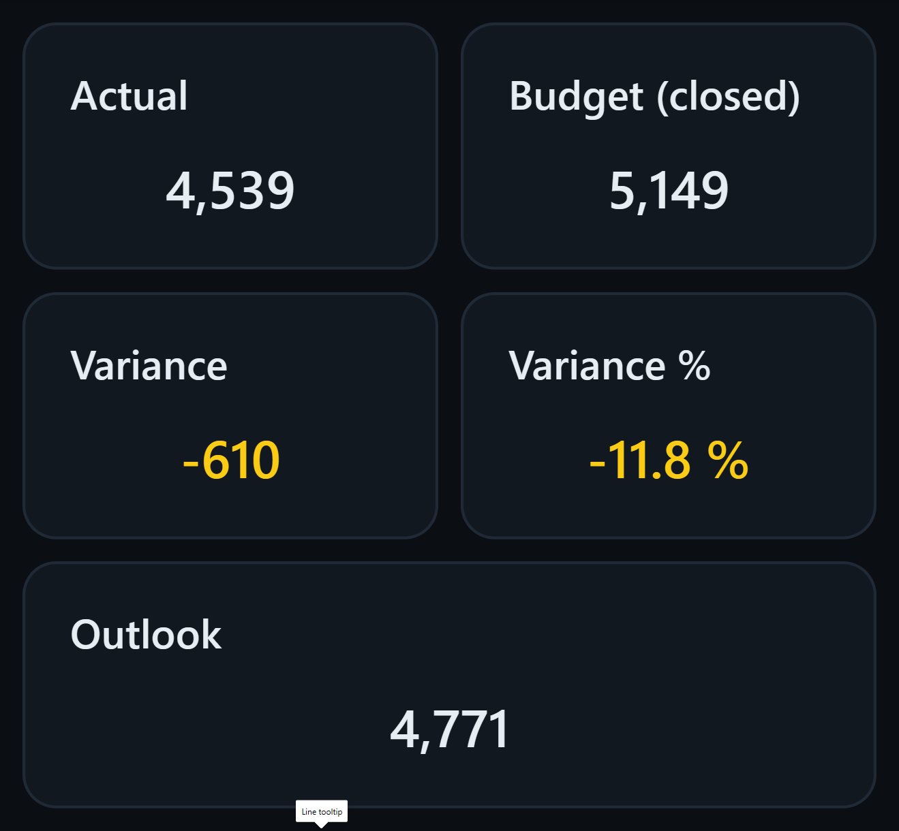

Das Budget wird nur mit den abgeschlossenen Monaten verglichen, Januar bis September 2025 im Ist also mit Januar bis September im Budget. Full year bedeutet Ist bis zum letzten abgeschlossenen Monat plus Forecast. Innerhalb von 1 % des Budgets (0,1 Prozentpunkte bei einer Marge) gilt eine Zeile als planmäßig.

Abteilungsleitungen sehen nur ihre eigene Abteilung: Die Rolle `Department head` filtert über die Anmeldeadresse und die Tabelle `Security`; eine neue Abteilungsleitung oder eine Leitung für mehrere Abteilungen ist eine neue Zeile in `data/security.csv`, keine Modelländerung.

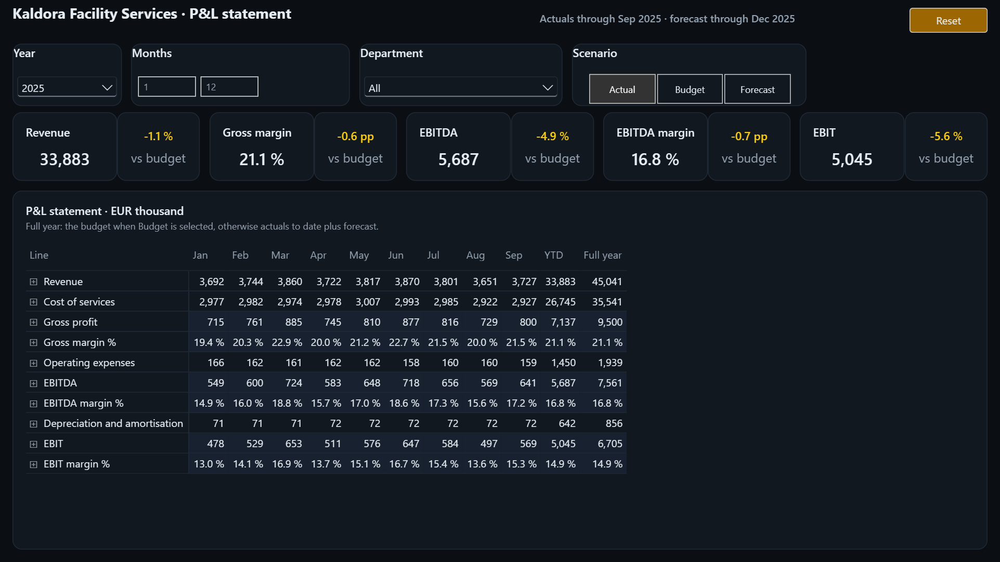

## So funktioniert es

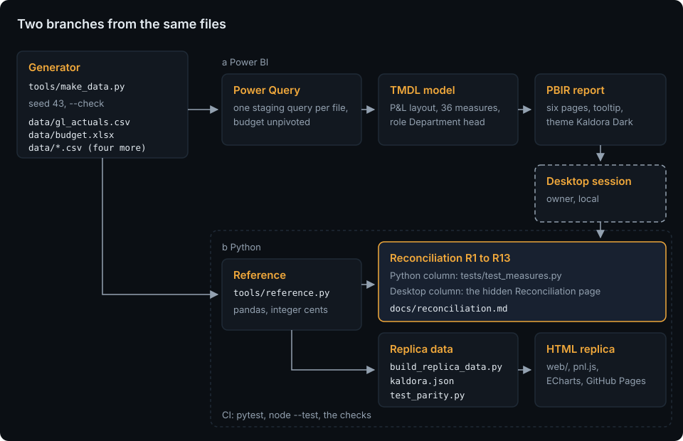

Der Generator mit festem Startwert schreibt die Dateien des Kundenunternehmens: den Kontensaldenexport, die Budgetarbeitsmappe mit dem Forecast-Blatt und vier CSV-Dateien. Power Query im Power-BI-Projekt liest jede Datei in einer eigenen Staging-Abfrage und entpivotiert die Budgetblätter; Modell und Bericht liegen als Text vor (TMDL und PBIR). Unabhängig davon berechnet `tools/reference.py` die Kennzahlen mit pandas in ganzen Cent. Beide treffen sich im [Abgleich](docs/reconciliation.md): Dreizehn Kennzahlen aus Python und aus Power BI Desktop müssen übereinstimmen. Dieselbe Referenz erzeugt die Daten der Nachbildung. Mehr in [docs/architecture.md](docs/architecture.md).

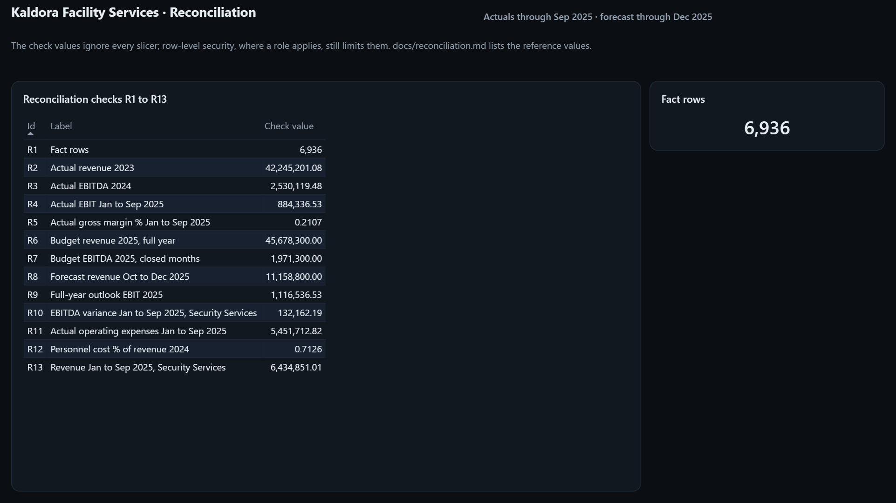

## Datenmodell

`FactGL` enthält Ist, Budget und Forecast in einer Tabelle, eine Zeile je Szenario, Monat, Kostenstelle und Konto, dazu `DimDate`, `DimAccount`, `DimCostCentre`, `DimScenario` und die Schematabelle `DimPnLLine`; die getrennten Tabellen `PnLColumn` (Spalten der Matrix) und `ReconCheck` (der Abgleich), die verborgene Tabelle `Security` für die Sicherheit auf Zeilenebene und 36 Kennzahlen in `_Measures`. Jeder Betrag wird als Beitrag zum Ergebnis gespeichert, Erlöse positiv und Aufwände negativ. Erlös- und Aufwandszeilen erscheinen im Anzeigevorzeichen, Aufwände also als positive Beträge, während Zwischensummen und Margen aus den vorzeichenbehafteten Werten entstehen. Eine Abweichung ist günstig, wenn sie das Ergebnis verbessert, ob die Zeile ein Erlös oder ein Aufwand ist. Tabellen, Spalten und die Regeln des Generators stehen in [docs/data-model.md](docs/data-model.md), jede Kennzahl mit ihrem DAX in [docs/measures.md](docs/measures.md).

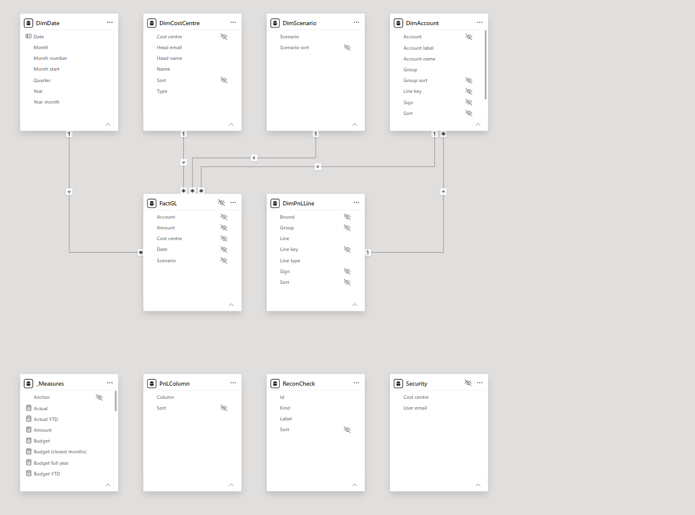

## Erste Schritte

Benötigt Python 3.13 mit [uv](https://docs.astral.sh/uv/), Power BI Desktop unter Windows für den Bericht und Node 22 für die Tests der Nachbildung.

```bash
git clone https://github.com/HARISPAARTAN/financial-reporting-dashboard.git
cd financial-reporting-dashboard
uv sync
uv run python tools/make_data.py --check      # die Daten entsprechen einem frischen Lauf
uv run pytest -q                               # Python-Tests, Referenz und Offline-Prüfungen des PBIP
node --test "tests/js/*.test.mjs"              # GuV-Rechnung und Diagrammoptionen der Nachbildung
```

`pbip/FinancialReportingDashboard.pbip` in Power BI Desktop öffnen. Start, Daten transformieren, Parameter bearbeiten: `DataFolder` auf den Ordner `data` des eigenen Klons setzen, mit abschließendem Backslash (Vorgabe `C:\financial-reporting-dashboard\data\`), übernehmen, dann Aktualisieren. Die verborgene Seite Reconciliation zeigt die dreizehn Prüfwerte.

Die Nachbildung lokal mit `uv run python -m http.server -d web 8000` ausliefern und http://127.0.0.1:8000/ öffnen. Monatsabschluss, neue Konten, Kostenstellen und Abteilungsleitungen: [docs/handover.md](docs/handover.md).

## Projektstruktur

```text
data/                erzeugte Datendateien: gl_actuals.csv, budget.xlsx und vier CSV-Dateien
pbip/                das Power-BI-Projekt: FinancialReportingDashboard.pbip, .SemanticModel (TMDL), .Report (PBIR, Design)
tools/               make_data.py, reference.py, build_replica_data.py, sync_kit.py, check_page_weight.py, pbi/, checks/
web/                 die Nachbildung: index.html, assets/ (pnl.js, charts.js, app.js, styles.css, data/), kit/, vendor/ (ECharts)
tests/               Python-Tests, pbi/ (Offline-Prüfungen des PBIP), js/ (node --test), fixtures/mini/
docs/                Auftrag, Datenmodell, Kennzahlen, Architektur, adr/, Übergabe, Desktop-Validierung, Abgleich, screenshots/
.github/             ci.yml, pages.yml, dependabot.yml
```

## Entscheidungen

- [ADR 0001: Eine GuV-Schematabelle und eine Vorzeichenregel](docs/adr/0001-pnl-layout-and-sign-convention.md)
- [ADR 0002: Staging-Abfragen je Datei und das Entpivotieren des Budgets](docs/adr/0002-power-query-staging-and-unpivot.md)
- [ADR 0003: Der Ausblick und das Budget der abgeschlossenen Monate](docs/adr/0003-forecast-outlook-and-closed-months.md)
- [ADR 0004: Eine pandas-Referenz und eine verborgene Abgleichsseite](docs/adr/0004-pandas-reference-and-reconciliation-page.md)

Die Entscheidungsdokumente sind auf Englisch.

## Im Vergleich zur ursprünglichen Lieferung

Dieser Nachbau ergänzt:

- einen schriftlichen Auftrag mit Nutzenden, Umfang und Abnahmekriterien sowie ein dokumentiertes Datenmodell mit dem GuV-Schema als eigener Tabelle;
- die Vorzeichenregel als Entscheidungsdokument, sodass Erlös- und Aufwandszeilen ihre Abweichungen nach einer Regel einfärben;
- Modell und Bericht als prüfbaren Text (TMDL und PBIR) mit Offline-Lint-Tests und Schemaprüfungen;
- den Abgleich von dreizehn Prüfwerten gegen eine unabhängige pandas-Berechnung, auch des Umsatzes, den eine Abteilungsleitung unter der Rolle sieht;
- Sicherheit auf Zeilenebene je Abteilung (eine Rolle mit einer Sicherheitstabelle) und ein Skript für die rollenfreie Kopie, die Publish to web braucht;
- Übergabenotizen zum Monatsabschluss, zu neuen Konten, Kostenstellen und Abteilungsleitungen;
- CI mit `uv sync --locked` und festgelegten Actions sowie eine Live-Nachbildung mit getesteter GuV-Rechnung.

Die echten Kontensalden und das echte Budget des Kundenunternehmens, der Produktivbetrieb und die Abnahme durch das Kundenunternehmen sind nicht übernommen; die Validierung in Power BI Desktop ist unter Status und in `docs/reconciliation.md` festgehalten.

## Lizenz und Hinweis zu den Daten

MIT, siehe [LICENSE](LICENSE). Alle Zahlen, Kontensalden und Personen in den Daten erfindet `tools/make_data.py`. Die Visual-Vorlagen in `tools/pbi/templates/` stammen aus microsoft/fabric-toolbox und die Schemas in `tools/pbi/schemas/` aus microsoft/json-schemas, beide MIT mit erhaltenen Lizenzen; ECharts 5.6.0 steht unter Apache-2.0 (`web/vendor/LICENSE-echarts.txt`); die Schriften in `web/kit/fonts/` stehen unter der SIL Open Font License.

Rebuilt from memory as a demo. The original client's name and data are not used.
