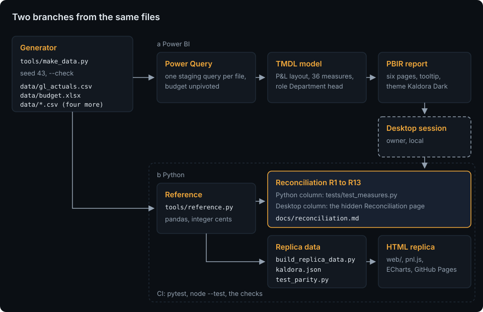

# Financial Reporting Dashboard

[](https://github.com/HARISPAARTAN/financial-reporting-dashboard/actions/workflows/ci.yml)
[](https://github.com/HARISPAARTAN/financial-reporting-dashboard/actions/workflows/pages.yml)
[](https://github.com/HARISPAARTAN/financial-reporting-dashboard/releases)

Power BI management P&L for a fictional facility-services company: a P&L layout with subtotals and margins in TMDL, one sign convention for every variance, budget against closed months only, a full-year outlook from actuals and the Q4 forecast, row-level security per department, the thirteen headline checks reconciled against an independent Python computation, and a live HTML replica.

Deutsch: [README.de.md](README.de.md)

## Status

- The data files equal a fresh build of `tools/make_data.py`, and the offline checks of the model and the report pass (`uv run pytest`).
- Not yet opened in Power BI Desktop.
- Not released yet.

## Client brief

> We are a facility-services company in Graz with four service lines (cleaning, technical maintenance, security, catering) and two support departments. Each month our controller exports the ledger balances by cost centre and account to CSV. The budget lives in an Excel workbook with one sheet per year, and after the September close we add a sheet with the Q4 forecast. We need a Power BI dashboard for management: income, expenses and margins as a proper P&L, actual versus budget by department and month, the year-end outlook, and a view of operating expenses. Department heads should see only their own department.

Rebuilt from memory as a demo. The original client's name and data are not used. Kaldora Facility Services is a fictional company; users, scope and acceptance criteria are in [docs/brief.md](docs/brief.md).

## Live demo

[harispaartan.github.io/financial-reporting-dashboard](https://harispaartan.github.io/financial-reporting-dashboard/)

The replica is a static page with three of the report pages as tabs (P&L statement, Variance, Trend), the same rules as the report (sign convention, closed-month budget, outlook, favourable status) and the filters Year, Months, Department and Scenario, plus a click on a department bar that filters the waterfall and the variance table. It is drawn with ECharts from the ledger facts that the Python reference writes, runs in the browser without a server and sends no data anywhere; your filters stay in this browser only. It leaves out the Opex page, the Department detail drill-through, the Info page (the About section replaces it), the tooltip page, the reconciliation page, row-level security, and on the Trend tab the cumulative and full-year charts and the Year and Months filters (the chart always shows 2023 to 2025).

## What it does

Eight report pages with the theme Kaldora Dark: six content pages and the hidden page Reconciliation on a 1280 × 720 canvas, and the tooltip page Line tooltip on 320 × 200. The content pages share a header with the data date and a Reset button, a slicer row (Year, Months, Department) synced across the pages, and a row of KPI tiles against budget.

- **P&L statement**: revenue, gross margin %, EBITDA, EBITDA margin % and EBIT against budget; a matrix of the ten P&L lines with subgroups and accounts below them, one column per month, YTD and Full year; the Scenario slicer switches the matrix between Actual, Budget and Forecast (the outlook).
- **Variance analysis**: budget EBIT, actual EBIT, the EBIT variance and the full-year outlook against budget; EBITDA variance by department; a waterfall from budget EBIT to actual EBIT by account group; the variance matrix with a status per line.
- **Trend**: actual, budget and forecast of one P&L line by month from 2023 to 2025, the cumulative lines within each year and the full year.
- **Opex**: operating expenses against budget, as a share of revenue and the personnel cost share; a treemap by subgroup and account, opex by department and the ten largest variances.
- **Department detail**: one department's P&L and EBITDA by month, reached by a drill-through from a department bar.
- **Info**: what the report shows, the sign convention, the definitions, the data files and the sources.

Budget is compared with the closed months only, so January to September 2025 of actuals meet January to September of the budget. Full year means actuals to the last closed month plus the forecast. Within 1 % of budget (0.1 pp on a margin) counts as on plan.

Department heads see only their own department: the role `Department head` filters by the sign-in address through the table `Security`, so a new head or a head for several departments is a new row in `data/security.csv`, not a model change.

## How it works



The seeded generator writes the client's files: the ledger export, the budget workbook with the forecast sheet and four CSV files. Power Query in the Power BI project reads each file in its own staging query and unpivots the budget sheets; the model and the report are plain text (TMDL and PBIR). Independently, `tools/reference.py` computes the measures with pandas in integer cents. The two meet in [the reconciliation](docs/reconciliation.md): thirteen headline numbers from Python and from Power BI Desktop must match. The same reference builds the replica's data. More in [docs/architecture.md](docs/architecture.md).

## Data model

`FactGL` holds actuals, budget and forecast in one table, one row per scenario, month, cost centre and account, with `DimDate`, `DimAccount`, `DimCostCentre`, `DimScenario` and the layout table `DimPnLLine`; the disconnected tables `PnLColumn` (matrix columns) and `ReconCheck` (the reconciliation), the hidden `Security` table for row-level security, and 36 measures in `_Measures`. Every amount is stored as its contribution to profit, income plus and expense minus. Revenue and cost lines show in display sign, so costs appear as positive amounts, while subtotals and margins are computed from the signed values. A variance is favourable when it raises profit, whether the line is income or cost. Tables, columns and the generator rules are in [docs/data-model.md](docs/data-model.md), every measure with its DAX in [docs/measures.md](docs/measures.md).

## Getting started

Needs Python 3.13 with [uv](https://docs.astral.sh/uv/), Power BI Desktop on Windows for the report, and Node 22 for the replica tests.

```bash
git clone https://github.com/HARISPAARTAN/financial-reporting-dashboard.git
cd financial-reporting-dashboard
uv sync
uv run python tools/make_data.py --check      # the committed data equal a fresh build
uv run pytest -q                               # Python tests, the reference and the offline checks of the PBIP
node --test "tests/js/*.test.mjs"              # the replica's P&L engine and chart options
```

Open `pbip/FinancialReportingDashboard.pbip` in Power BI Desktop. Home, Transform data, Edit parameters: set `DataFolder` to the `data` folder of your clone with a trailing backslash (the default is `C:\financial-reporting-dashboard\data\`), apply, then Refresh. The hidden page Reconciliation shows the thirteen checks.

Serve the replica locally with `uv run python -m http.server -d web 8000` and open http://127.0.0.1:8000/. The monthly close, new accounts, cost centres and department heads: [docs/handover.md](docs/handover.md).

## Project layout

```text
data/                generated data files: gl_actuals.csv, budget.xlsx and four CSV files
pbip/                the Power BI project: FinancialReportingDashboard.pbip, .SemanticModel (TMDL), .Report (PBIR, theme)
tools/               make_data.py, reference.py, build_replica_data.py, sync_kit.py, check_page_weight.py, pbi/, checks/
web/                 the replica: index.html, assets/ (pnl.js, charts.js, app.js, styles.css, data/), kit/, vendor/ (ECharts)
tests/               Python tests, pbi/ (offline checks of the PBIP), js/ (node --test), fixtures/mini/
docs/                brief, data model, measures, architecture, adr/, handover, Desktop validation, reconciliation, screenshots/
.github/             ci.yml, pages.yml, dependabot.yml
```

## Decisions

- [ADR 0001: A P&L layout table and one sign convention](docs/adr/0001-pnl-layout-and-sign-convention.md)
- [ADR 0002: Staging queries per file and the budget unpivot](docs/adr/0002-power-query-staging-and-unpivot.md)
- [ADR 0003: The outlook and the closed-month budget](docs/adr/0003-forecast-outlook-and-closed-months.md)
- [ADR 0004: A pandas reference and a hidden reconciliation page](docs/adr/0004-pandas-reference-and-reconciliation-page.md)

## Compared with the original delivery

This rebuild adds:

- a written brief with users, scope and acceptance criteria, and a documented data model with the P&L layout as its own table;
- the sign convention as a decision record, so income and cost lines colour their variances by one rule;
- the model and the report as reviewable text (TMDL and PBIR) with offline lint tests and schema checks;
- thirteen headline checks reconciled against an independent pandas computation, including the revenue a department head sees under the role;
- row-level security that is checked, and a script for the role-free copy that Publish to web needs;
- handover notes for the monthly close, new accounts, cost centres and department heads;
- CI with `uv sync --locked` and pinned actions, and a live replica with a tested P&L engine.

## Licence and data note

MIT, see [LICENSE](LICENSE). Every number, account balance and person in the data is invented by `tools/make_data.py`. The visual templates in `tools/pbi/templates/` come from microsoft/fabric-toolbox and the schemas in `tools/pbi/schemas/` from microsoft/json-schemas, both MIT with their licences kept; ECharts 5.6.0 is Apache-2.0 (`web/vendor/LICENSE-echarts.txt`); the fonts in `web/kit/fonts/` are under the SIL Open Font License.

Rebuilt from memory as a demo. The original client's name and data are not used.
