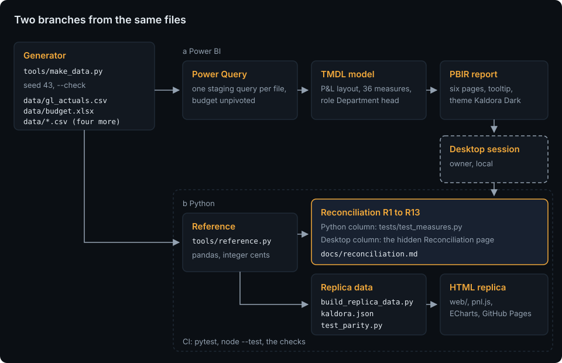

# Architecture

The seeded generator writes the files the client would have: the monthly ledger export, the budget workbook with the Q4 forecast sheet and four CSV files. Two branches read them independently:

- **a, Power BI:** Power Query in the PBIP reads each file in its own staging query, unpivots the budget sheets into rows and turns every amount into its profit contribution; the TMDL model holds the facts, the P&L layout, the 36 measures and the role `Department head`; the PBIR report shows six pages, a tooltip page and a hidden reconciliation page with the theme `Kaldora Dark`.
- **b, Python:** `tools/reference.py` reads the same files with pandas (the workbook through openpyxl) and computes the measures in integer cents. `tests/test_measures.py` checks the Python column of the reconciliation table against it; `tools/build_replica_data.py` turns the facts and four reference states into `web/assets/data/kaldora.json`.

The branches meet in [the reconciliation table](reconciliation.md): thirteen headline numbers, computed by Python and read from the hidden Reconciliation page in Power BI Desktop, must match ([ADR 0004](adr/0004-pandas-reference-and-reconciliation-page.md)).

## Layout

| Path | What it is |
|---|---|
| `data/` | the generated data files ([data model](data-model.md)) |
| `pbip/FinancialReportingDashboard.pbip` | the Power BI project; `FinancialReportingDashboard.SemanticModel/` holds the TMDL model and `diagramLayout.json`; `FinancialReportingDashboard.Report/` holds the PBIR report and the theme |
| `tools/make_data.py` | the generator |
| `tools/reference.py` | the pandas reference: facts, line values, scenarios, variances, the reconciliation checks and the replica states |
| `tools/build_replica_data.py` | `web/assets/data/kaldora.json`: the facts as integer cents and the reference values of the states S1 to S4 |
| `tools/pbi/` | the report generator and the model tools (below) |
| `tools/sync_kit.py` | portfolio-kit's reference script: vendors the kit into `web/kit/` and checks the copy |
| `tools/check_page_weight.py`, `tools/checks/` | page weight, contrast, link check, scrub, screenshots and the replica check |
| `web/` | the replica: `index.html`, `assets/styles.css`, `assets/pnl.js` (the measures), `assets/charts.js` (the chart options), `assets/app.js` (the page), `assets/data/kaldora.json`, `kit/`, `vendor/` (ECharts 5.6.0) |
| `tests/` | Python tests, `pbi/` (offline checks of the PBIP), `js/` (`node --test`), `fixtures/mini/` |

## The Power BI tooling

`tools/pbi/` comes from the sibling repository sales-performance-dashboard, which took it from energiewende-monitor. Everything specific to this report lives in `project.json`, `pages.json`, the TMDL files and the theme inputs; this repository extends three of the shared files for the visuals a P&L needs:

| File | What it does |
|---|---|
| `project.json` | the project's names: PBIP folder, report and model folder names, theme name and file, display units, the tables the public variant drops |
| `pages.json` | the report as data: canvas, header, slicer row, sync groups, KPI tiles and the visuals of each page, drill-through, tooltip and hidden pages, interactions |
| `pbir.py` | PBIR building blocks: visuals from the templates, field references, filters, sync groups, tooltip pages, bookmarks and buttons; here also the waterfall and the treemap without a template and the Back button |
| `build_report.py` | writes the report folder from `pages.json`; here also matrices (stepped layout, subtotals, the row tint), conditional formatting by field value, line styles, drill-through binding, page visibility and visual interactions; run only until the first save in Desktop |
| `build_theme.py` | writes the report theme from `web/kit/tokens.css` and the kit palette (`--check` compares instead); here also display units none |
| `tmdl.py` | a reader for the TMDL subset this model uses, for the lint tests |
| `diagram_layout.py` | writes `diagramLayout.json` for the model view |
| `make_public_variant.py` | builds the role-free copy under `build/public/` that Publish to web needs (no role, no `Security` table) |
| `copy_tom.py` | copies the TOM assemblies into the git-ignored `build/tom/` for the optional parse test |
| `vendor_schemas.py`, `schemas/`, `schema_versions.json` | the pinned PBIR and PBIP JSON schemas (microsoft/json-schemas, MIT) |
| `templates/` | visual templates (microsoft/fabric-toolbox, MIT) |

The generic parts of the tooling still build the sibling's report byte for byte; `tests/pbi/test_copied_files.py` checks the files that stay identical. Until the first save in Desktop, `pages.json` and `build_report.py` are the source of the report and the TMDL files are edited directly. After that save, the files Desktop wrote are the source and `build_report.py` is not run again ([Desktop validation](desktop-validation.md)).

## The replica

`web/index.html` is one page with three tabs (P&L statement, Variance, Trend) and hash routes (`#variance`). `pnl.js` is a pure ES module without DOM access: it implements the line values, the outlook, the closed-month budget, the variance and the favourable flag on the facts of `kaldora.json`, and `tests/js/pnl.test.mjs` recomputes the four reference states S1 to S4 with it. `charts.js` builds the ECharts options (department bars, the waterfall as stacked bars on a transparent base, the trend lines); `app.js` wires the filter bar, the tabs, the tables and the kit's filter bus, and remembers the view under `pf.financial-reporting-dashboard.v1`.

What the replica leaves out: the Opex page, the Department detail drill-through, the Info page (the About section replaces it), the tooltip page, the reconciliation page, row-level security, on the Variance tab the four EBIT tiles and the subgroup and account rows of the variance matrix, the bookmark (the Reset button does its job), on the Trend tab the cumulative and full-year charts (the chart always shows 2023 to 2025), and any export. The report is dark only; the replica also follows the light theme of the portfolio.

## CI

`.github/workflows/ci.yml` runs on every push and pull request on Ubuntu 24.04: job `python` (lint, format, the lock, all Python tests, `make_data.py --check`, `build_replica_data.py --check`, `build_theme.py --check`, the scrub), job `replica` (`node --test`, contrast, page weight, the offline link check) and job `kit` (portfolio-kit at the pinned tag, `sync_kit.py --check`). `.github/workflows/pages.yml` deploys `web/` to GitHub Pages.
