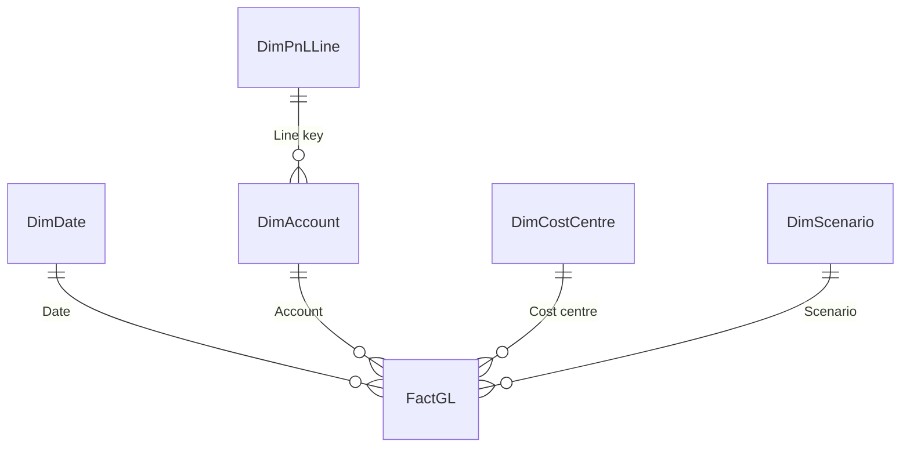

# Data model

Two sources, as in the brief: the controller's monthly ledger export (balances by cost centre and account) and the budget workbook with one sheet per year and the Q4 forecast sheet, plus three small master-data files and the security list. Everything below is generated by `tools/make_data.py` with seed 43 and committed under `data/`; `tests/test_make_data.py` holds the rules and the bands, and `tests/pbi/test_tmdl_lint.py` holds the model.

## Files

CSV files are UTF-8 without BOM, LF line endings, comma-separated and `.` as decimal separator. Every file is at most 2 MB.

| File | Rows | Columns |
|---|---|---|
| `data/gl_actuals.csv` | 3,178 balances, 2023-01 to 2025-09 | `period` (`2025-09`), `cost_centre` (`CC10`), `account` (`4000`), `amount` (EUR, two decimals, ledger sign: debit +, credit −, so revenue is negative); zero balances are not exported |
| `data/budget.xlsx` | 98 data rows per sheet | sheets `Budget 2023`, `Budget 2024`, `Budget 2025`, `Forecast 2025`: A1 the title (`Kaldora Facility Services · Budget 2025`), A2 the note (`EUR · revenue and costs as positive amounts · revenue reductions negative`), row 3 empty, row 4 the header `Cost centre`, `Account`, `Account name`, `Jan` to `Dec`, `FY` (the forecast sheet: `Oct`, `Nov`, `Dec`, `Q4`), rows 5 to 102 the 98 pairs sorted by cost centre and account, row 103 `Total`; values in whole hundreds of EUR in natural sign, zero months empty; `FY`, `Q4` and `Total` are SUM formulas without cached values |
| `data/chart_of_accounts.csv` | 40 | `account`, `name`, `group`, `subgroup`, `sign` (+1 income, −1 expense), `sort_order` |
| `data/cost_centres.csv` | 6 | `cost_centre`, `name`, `type` (Operating, Support), `head_name`, `head_email`, `sort_order` |
| `data/pnl_layout.csv` | 10 | `line_key`, `line`, `line_type` (Group, Subtotal, Ratio), `group`, `bound`, `sign`, `sort_order` |
| `data/security.csv` | 10 | `user_email`, `cost_centre`: each department head with their own cost centre, and the Head of Operations with CC10 to CC40 |

The workbook is written without compression, with the fixed entry time 2025-10-06 00:00 and fixed document properties, so every run writes the same bytes.

## P&L layout and sign convention

| Sort | Key | Line | Type | Group or bound | Sign |
|---|---|---|---|---|---|
| 10 | REV | Revenue | Group | Revenue | +1 |
| 20 | COS | Cost of services | Group | Cost of services | −1 |
| 30 | GP | Gross profit | Subtotal | bound 30 | +1 |
| 35 | GPM | Gross margin % | Ratio | bound 30 | +1 |
| 40 | OPEX | Operating expenses | Group | Operating expenses | −1 |
| 50 | EBITDA | EBITDA | Subtotal | bound 50 | +1 |
| 55 | EBITDAM | EBITDA margin % | Ratio | bound 50 | +1 |
| 60 | DA | Depreciation and amortisation | Group | Depreciation and amortisation | −1 |
| 70 | EBIT | EBIT | Subtotal | bound 70 | +1 |
| 75 | EBITM | EBIT margin % | Ratio | bound 70 | +1 |

The export uses the ledger sign: debit plus, credit minus, so revenue is negative. The model stores every amount as its contribution to profit, income plus and expense minus: actuals become `−amount`, and the budget and forecast cells (natural sign) become `value × sign` of their account. A Group line and every subgroup and account below it show `signed × line sign`, so costs appear as positive amounts; a Subtotal is the plain signed sum of all accounts whose group sorts below its bound; a Ratio is that subtotal divided by Revenue. Variance is Actual − Budget in display sign and is favourable when `Variance × line sign > 0`; `Profit impact = Variance × line sign` is the effect on EBIT, so the four group impacts add up to the EBIT variance ([ADR 0001](adr/0001-pnl-layout-and-sign-convention.md)).

## Model

The model lives in `pbip/FinancialReportingDashboard.SemanticModel/definition/` (TMDL): culture en-US, `discourageImplicitMeasures`, compatibility level 1606. Hidden columns are marked h.

| Table | Grain and source | Columns |
|---|---|---|
| `FactGL` | scenario × month × cost centre × account; `src_GL` and the unpivoted `src_Budget` combined, 6,936 rows (3,178 actual, 3,468 budget, 290 forecast) | `Date` h (first of the month), `Cost centre` h, `Account` h, `Scenario` h, `Amount` h (profit contribution, `Currency.Type`) |
| `DimDate` | day from `StartDate` to `EndDate`, 1,096 rows; marked as date table on `Date` | `Date`, `Year`, `Quarter` (`Q3`), `Month number`, `Month` (`Sep`, sorted by `Month number`), `Month start`, `Year-month` (`2025-09`) |
| `DimAccount` | account; `chart_of_accounts.csv` and the layout | `Account` h, `Account name`, `Account label` (`4000 Cleaning contracts`, sorted by `Sort` h), `Group` (sorted by `Group sort` h), `Subgroup` (sorted by `Subgroup sort` h, the smallest account sort of the subgroup), `Sign` h, `Line key` h |
| `DimPnLLine` | P&L line; `pnl_layout.csv` | `Line key` h, `Line` (sorted by `Sort` h), `Line type`, `Group` h, `Bound` h, `Sign` h |
| `DimCostCentre` | cost centre; `cost_centres.csv` | `Cost centre` h, `Name` (sorted by `Sort` h), `Type`, `Head name`, `Head email` |
| `DimScenario` | scenario; an M `#table` | `Scenario` (sorted by `Scenario sort` h: Actual, Budget, Forecast) |
| `Security` | user × cost centre; `security.csv`; hidden, no relationship | `User email`, `Cost centre` |
| `PnLColumn` | the matrix columns; an M `#table`, no relationship | `Column` (`Jan` to `Dec`, `YTD`, `Full year`, sorted by `Sort` h) |
| `ReconCheck` | the checks R1 to R13; an M `#table`, no relationship | `Id` (sorted by `Sort` h), `Label`, `Kind` (amount, ratio or count) |
| `_Measures` | the 36 measures ([measures](measures.md)); one hidden anchor column | `Anchor` h |

Relationships, all many-to-one with single-direction filtering:

| From | To |
|---|---|
| `FactGL[Date]` | `DimDate[Date]` |
| `FactGL[Account]` | `DimAccount[Account]` |
| `FactGL[Cost centre]` | `DimCostCentre[Cost centre]` |
| `FactGL[Scenario]` | `DimScenario[Scenario]` |
| `DimAccount[Line key]` | `DimPnLLine[Line key]` |

`DimPnLLine` filters the facts through `DimAccount`, so a Group line holds its accounts. A Subtotal or Ratio line has no accounts of its own: its value removes the line filter and sums the accounts below the bound. `Security` has no relationship; the role `Department head` filters `DimCostCentre` by the cost centres listed for the sign-in address, and that filter reaches `FactGL` through the normal relationship.

## Power Query

Parameters: `DataFolder` (text, default `C:\financial-reporting-dashboard\data\` with the trailing backslash; set it to the clone's `data` folder), `StartDate` = 2023-01-01 and `EndDate` = 2025-12-31. The staging queries live in `expressions.tmdl`, are not loaded, and each touches exactly one file ([ADR 0002](adr/0002-power-query-staging-and-unpivot.md)):

- `src_GL`: `gl_actuals.csv`; `Date` = the first of the month of `period`, `Amount` = −`amount` as `Currency.Type`, `Scenario` = `Actual`.
- `src_Budget`: `budget.xlsx`; per sheet the three rows above the header skipped and the header promoted, only rows whose `Cost centre` starts with `CC`, then `Table.UnpivotOtherColumns` on `Cost centre` and `Account`, which turns the month columns into rows; empty and zero values dropped; `Scenario` and `Year` from the sheet name, `Date` from the year and the month name. `FY`, `Q4` and `Total` never reach the facts.
- `src_Accounts`, `src_CostCentres`, `src_Layout`, `src_Security`: one CSV each.

The `FactGL` partition only references: `src_Budget` merged with `src_Accounts` on `Account` for the sign, `Amount` = value × sign, combined with `src_GL`. Every type conversion passes the culture `en-US`, so a Desktop with German regional settings still reads `.` decimals.

## Generator

`uv run python tools/make_data.py [--out data] [--check]`. Seed 43 for `numpy.random.default_rng` (the noise on the actuals); Faker `de_AT` draws the seven person names with its own seed `NAME_SEED` (43). `--check` regenerates into a temporary folder and compares the SHA-256 of all six files.

- Plan (the budget): 2023 revenue CC10 EUR 19.0 m, CC20 9.4 m, CC30 7.6 m, CC40 6.2 m, split into contract, ad-hoc, recharge and reduction accounts by a mix per department; contract prices step up 5.0 % in January 2024 and 3.5 % in January 2025, ad-hoc revenue grows 3 % a year. Material recharges (4200) follow the department's ad-hoc account; revenue reductions (4900) are a fixed share of the department's revenue of the month.
- Direct costs are shares of the department's planned revenue (direct personnel 75 % fixed and 25 % following the planned revenue index; materials, subcontractors, vehicles and equipment following the index); planned wage rounds + 6.0 % (2024) and + 4.0 % (2025).
- Overheads and depreciation: fixed amounts a year that grow 3 % a year (salaries follow the wage round instead); sales commissions (6320) are 0.3 % of the company's planned revenue of the month; trade fairs (6310) fall in March, September and October, bad debt (6450) in December.
- Seasonality: six monthly profiles with mean 1 (spring and autumn cleaning, heating and cooling, events, canteen, temporary staff, energy).
- Actuals: the plan with the actual wage level and the events, times (1 + ε) per pair and month with ε normal around 0 (1 % on contract revenue up to 8 % on subcontractors, none on depreciation).
- Events in the actuals: E1 the 2024 wage round was + 7.0 % instead of + 6.0 %; E2 the ERP migration (6410 at Administration + EUR 60,000 in each of October and November 2024; 6200 + 15 % from October 2024); E3 a bad debt of EUR 85,000 in December 2024 against a budget of EUR 25,800; E4 food prices + 6 % from February 2025; E5 a lost cleaning contract from April 2025 (6 % of 4000) and 5 % fewer cleaning staff from June 2025; E6 summer event contracts at Security Services, June to August 2025; E7 extra vans at Technical Maintenance from April 2025.
- Budget: the plan rounded to EUR 100; the 2025 budget starts from the actual 2024 wage level and IT run rate, so it is close to the actuals but never equal.
- Forecast (October to December 2025): the budget of the month times (1 + half of the year-to-date deviation of the pair), rounded to EUR 100; the lost cleaning contract and the smaller cleaning staff are carried in full, and the summer event accounts return to plain budget.

`NAME_SEED` (43) seeds Faker and changes names and e-mail addresses only, never a number: if a generated person name ever collides with a term the repository must not contain, raise it by one and regenerate. A new Faker release can change the names too ([handover](handover.md#updating-faker-or-numpy)).

Bands that `tests/test_make_data.py` holds, with the values of the committed files (2025 compares the closed months January to September):

| Band | Holds | Committed files (2023 / 2024 / 2025) |
|---|---|---|
| revenue, actual against budget | within ± 3 % | + 0.11 % / − 0.06 % / − 1.06 % |
| each department's revenue against budget | within ± 6 % | Cleaning + 0.02 / − 0.30 / − 3.88 %, Technical Maintenance − 0.06 / + 0.32 / + 0.19 %, Security + 0.50 / + 0.43 / + 3.42 %, Catering + 0.13 / − 0.46 / + 0.14 % |
| EBITDA against budget | within ± 25 % | + 3.07 % / − 14.09 % / − 14.49 % |
| EBITDA January to September 2025 | below budget | − 14.49 % |
| gross margin | 19–26 % | 23.20 % / 22.00 % / 21.07 % |
| EBITDA margin | 4–9 % | 7.47 % / 5.73 % / 4.98 % |
| personnel cost of revenue | 66–75 % | 69.81 % / 71.26 % / 71.81 % |

Each event E1 to E7 moves its accounts in the stated direction (`tests/test_make_data.py`, one test per event).
